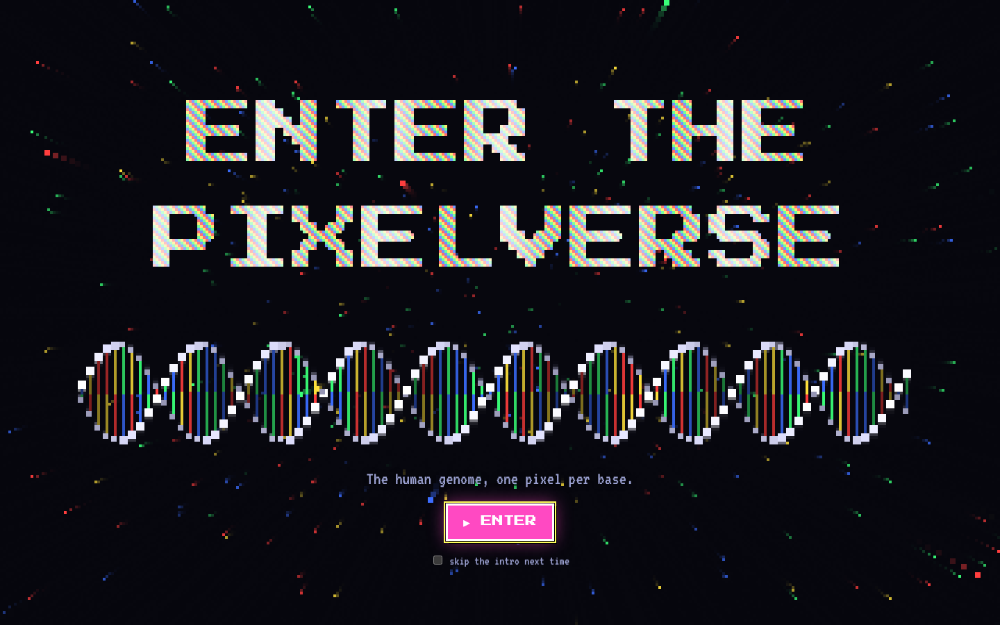
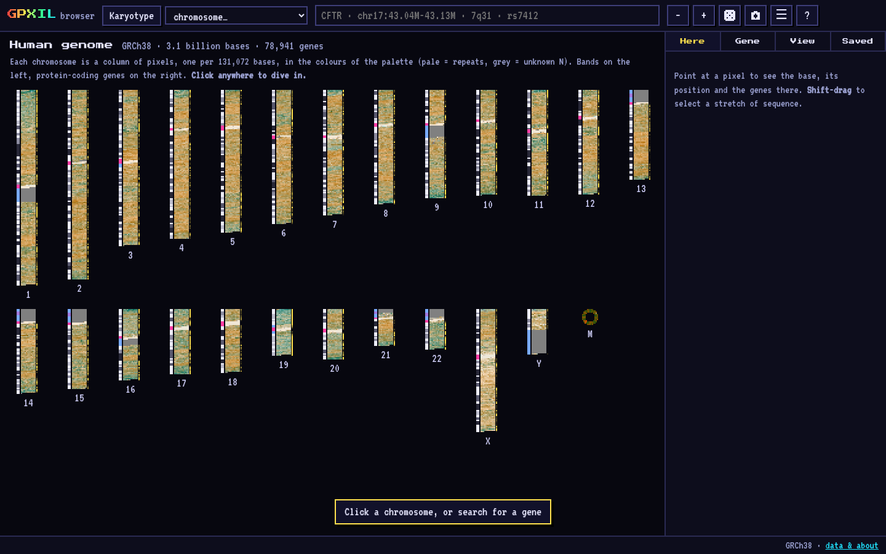
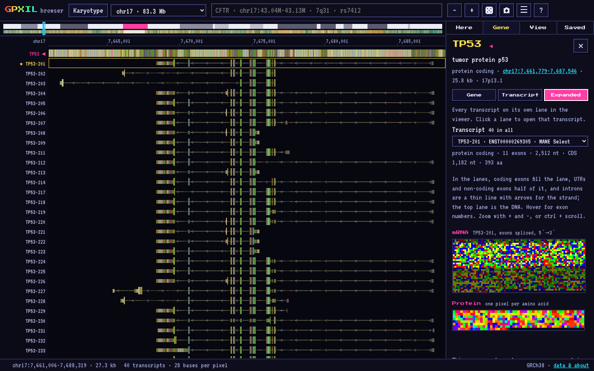
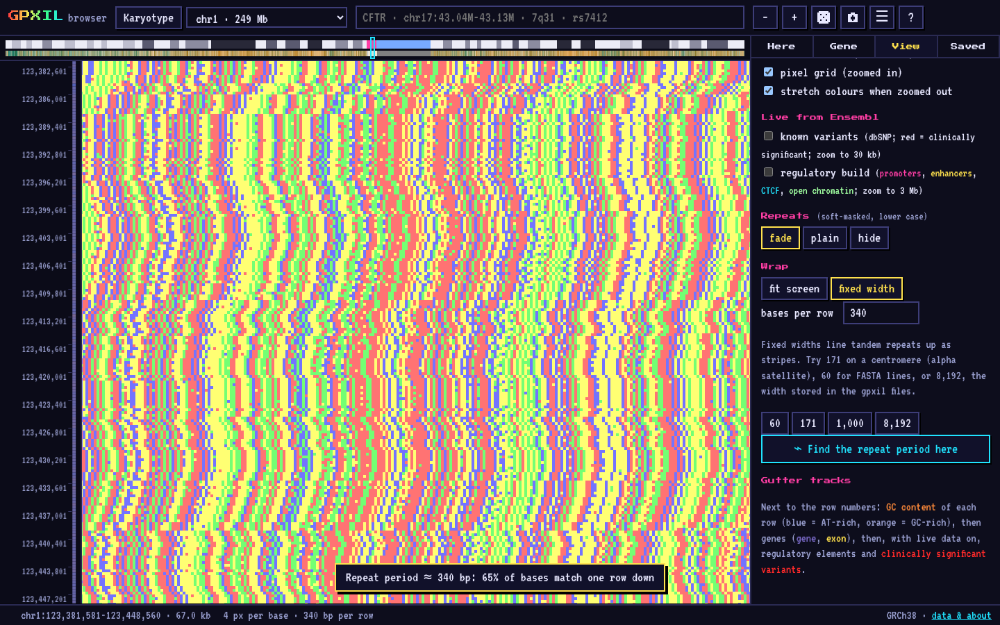

# Gpxil browser: enter the pixelverse

A genome browser for the human reference genome (GRCh38) in which the view is
nothing but pixels: one pixel per base, read straight from
[gpxil](https://github.com/comparativechrono/Gpxil) files, the image format for
genomes that follows Albrecht-Buehler's genome pixel images
([PLoS ONE, 2009](https://doi.org/10.1371/journal.pone.0004701)).

It is a static site for GitHub Pages: **https://comparativechrono.github.io/Gpxil-browser/**
(live once Pages is switched on, see [Deploying](#deploying)).



| | |
|---|---|
|  |  |
| The karyotype, one pixel per 131,072 bases | Expanded: every transcript of TP53 on its own lane |
|  | |
| Alpha satellite on chr1, wrapped at the repeat period the browser found (340 bp) | |

## What you can do

**Move around the genome**

- **Karyotype**: all 24 chromosomes as columns of pixels, coloured by base
  content, with cytobands on the left and protein-coding gene density on the
  right. chrM, far smaller than one karyotype pixel, is drawn as a ring
  (it is circular). Click anywhere to dive in.
- **Chromosome view**: the bases wrap into rows like lines of text. Zoom runs
  from 262,144 bases per pixel to 64 pixels per base; from 12 pixels per base
  the letters appear. Scroll, drag, pinch, double-click, or use the keyboard.
- **Ideogram** above the view: cytobands, the chromosome's own pixels, and a
  bracket for the part on screen; click or drag it to jump.
- **Gutter tracks** beside the row numbers: GC content of each row, genes and
  exons, and live data when it is switched on.
- **Wrap**: fit the screen, or a fixed number of bases per row, which lines up
  tandem repeats as stripes. *Find the repeat period here* picks the width for
  you by autocorrelation.

**Search** (press `/`)

- Genes by HGNC symbol, alias or previous symbol (HER2 finds ERBB2), or
  Ensembl gene ID; anything else (transcript IDs, other synonyms) is looked
  up in Ensembl.
- Places: `chr7:117,480,025-117,668,665`, `X:73.8M`, `17:7.66M-7.69M`, a
  whole chromosome, or a cytoband (`17q21.31`, `7q3`).
- Variants by rsID (`rs334`), placed through Ensembl.

**Genes**

- The gene's pixels stay lit while the rest of the view dims.
- Three modes (`1` `2` `3`):
  - **Gene**: the whole gene lit up in the genome.
  - **Transcript**: one transcript lit up in the genome (exons bright, UTRs
    half-lit, introns dimmed); pick any transcript from the list.
  - **Expanded**: every transcript of the gene on its own lane, like the
    expanded gene track of a classic browser but drawn with the gene's pixels:
    coding exons fill the lane, UTRs and non-coding exons half of it, introns
    are a thin line with arrows for the strand, and the top lane is the DNA.
    Zoom and scroll the lanes; click one to open that transcript.

  All 646,577 transcripts of Ensembl 116 are stored with the site, so these
  modes need no outside call.
- The spliced mRNA and the protein drawn as pixels (one pixel per amino acid,
  translated here, with the mitochondrial code on chrM and selenocysteine where
  Ensembl marks it); hover for codon and position.
- The NCBI Gene summary; links to Ensembl, NCBI Gene, HGNC, UniProt and OMIM;
  previous and next gene (`[` `]`).

**Take the pixels home**

- **pxil files** of the gene, the transcript and the protein you are looking
  at (`gene.pxil`, `transcript.pxil`, `protein.pxil`), or of any number of the
  gene's transcripts and proteins at once, zipped. Every file name carries the
  Ensembl ID (ENSG, ENST or ENSP), for example
  `TP53-201_ENSP00000269305.protein.pxil`. [pxil](https://github.com/comparativechrono/pxil)
  is a simple format for single sequences: a PNG image, one pixel per base or
  amino acid, whose pixel values are the sequence, so it opens in image
  software and reads back exactly. It is meant for quick analysis and sharing,
  not for keeping genomes.
- **The genome as gpxil**: every chromosome's gpxil file (the files the browser
  reads), and the whole of GRCh38 in one file, `GRCh38.gpxil.tif`, published as
  a [release](https://github.com/comparativechrono/Gpxil-browser/releases)
  because it is too big for the site.
- Links to the [gpxil specification](https://github.com/comparativechrono/Gpxil/blob/main/gpxil-spec.pdf)
  and the [pxil specification](https://github.com/comparativechrono/pxil/blob/main/pxil-spec.pdf).

**Like a traditional browser, but in pixels**

- Hover any pixel for its base, position, band, gene, exon/intron/UTR and, with
  live data on, variants and regulatory elements. Moving with the keyboard, the
  base in the middle of the view is the one described.
- Shift-drag to select bases: length, GC, the sequence, copy, FASTA, and the
  same place in Ensembl, UCSC or NCBI.
- Live tracks from Ensembl: known variants (dbSNP, with consequences;
  clinically significant ones in red) and the regulatory build (promoters,
  enhancers, CTCF sites, open chromatin).
- CpG sites, base letters, a pixel grid, six palettes (Classic, GPxI greys,
  Okabe-Ito, Process inks, Neon, GC heat), and repeats faded, plain or hidden.
- Every view has its own link (the address bar), saved places, a picture of the
  view (`P`), and a random gene (`R`). There may be other surprises.
- Whenever something takes a while, a pixel double helix spins and says what it
  is waiting for.

## How it works

The site has no build step: plain HTML, CSS and JavaScript modules in
[`site/`](site/). The data is built by [`pipeline/`](pipeline/) into
`site/data/grch38/`:

| Files | What | Size |
|---|---|---|
| `gpxil/chr*.gpxil.tif`, `gpxil/unplaced.gpxil.tif` | The reference as gpxil: one reference-only file per chromosome, 8,192 bases per row, Deflate, 256 KiB strips; the 169 unplaced and unlocalised scaffolds share one file | 849 MB |
| `overview/*.ov.gz` | Summary bins for zoomed-out views: for bins of 128 to 131,072 bases, GC, N and soft-masked fractions | 39 MB |
| `genes/*.json.gz` | 78,941 genes (Ensembl 116) with HGNC names, cross-references and canonical transcripts; a search index; 58,149 aliases | 8 MB |
| `transcripts/*.bin` | All 646,577 transcripts, one gzip member per gene, so a gene's transcripts take one range request (the gene's row says where) | 21 MB |
| `karyotype.json`, `cytobands.json.gz`, `manifest.json` | The karyotype bins, cytobands, and the index of everything | 0.1 MB |

The browser never downloads a whole chromosome. Like a cloud-optimised
GeoTIFF, a gpxil file can be read in pieces: the manifest gives each contig's
TIFF page, and the browser reads the page's strip table and then only the
strips under the view, with HTTP range requests, and inflates them with the
browser's own `DecompressionStream`. Zoomed out, it reads the summary bins
instead.

Some things are not stored on the site but fetched live, only when asked for:

| From | What |
|---|---|
| [Ensembl REST API](https://rest.ensembl.org) | Transcript IDs and other gene names, rsIDs, variants and regulatory elements in view |
| [MyGene.info](https://mygene.info) | Gene summaries from NCBI Gene |

## Building the data

Python 3.10 or later:

```sh
pip install -r pipeline/requirements.txt
python -I pipeline/build.py --out site/data/grch38
```

This downloads the GRCh38 soft-masked primary assembly and the gene set of
Ensembl release 116, the HGNC complete set and the cytobands (about 1 GB, kept
in `.cache/`), and takes about ten minutes. Any input can be given as a local
file instead (`--fasta`, `--gtf`, `--hgnc`, `--bands`); `--only chr21,chrM`
makes a quick partial build.

Then serve the site with range requests (Python's own `http.server` ignores
them, which makes everything slow):

```sh
python dev/serve.py        # http://localhost:8000
```

## Deploying

[`.github/workflows/pages.yml`](.github/workflows/pages.yml) builds the data,
adds the site and deploys it to GitHub Pages on every push to `main`. The data
is cached between runs and rebuilt only when `pipeline/` changes, when the
cache has expired, or when the workflow is run by hand with *rebuild* ticked.

One-time setup: in the repository's **Settings → Pages → Build and
deployment**, set **Source** to **GitHub Actions**.

The whole site is about 920 MB, inside GitHub Pages' 1 GB limit for a site.

The whole genome in one gpxil file does not fit beside it, so
[`.github/workflows/release-grch38.yml`](.github/workflows/release-grch38.yml),
run by hand (**Actions → GRCh38 gpxil release → Run workflow**), encodes it
with gpxiltools and publishes it as a release asset, which may be up to 2 GB.

## Tests

```sh
pip install -r pipeline/requirements.txt -r tests/requirements.txt
python -m pytest tests/test_pipeline.py      # builds a toy genome's data and checks it
node --test tests/js/browser.test.mjs        # the browser's modules on that data
```

The toy genome ([`tests/fixture.py`](tests/fixture.py)) has soft-masked
repeats, a run of Ns, scaffolds, and genes on both strands and on chrM whose
proteins are known in advance, so the tests check reading bases over range
requests, the summary bins, gene search, and splicing and translation end to
end. [`.github/workflows/tests.yml`](.github/workflows/tests.yml) runs them on
every push.

With the full data built and `dev/serve.py` running, three Playwright scripts
drive a real browser: `python tests/smoke.py` and `python tests/scenarios.py`
click through the site and save screenshots to `tests/output/`, and
`python tests/regressions.py` checks behaviour that once went wrong (links that
keep their zoom, late Ensembl answers, pinches, keyboard use and so on).

## Data sources

- Sequence and genes: [Ensembl](https://www.ensembl.org) release 116, GRCh38.p14.
  Ensembl imposes no restrictions on access to, or use of, its data
  ([disclaimer](https://www.ensembl.org/info/about/legal/disclaimer.html)).
- Gene names, aliases and cross-references: [HGNC](https://www.genenames.org),
  released under CC0 ([licence](https://www.genenames.org/about/license/)).
  Please cite *Genenames.org: the HGNC resources in 2023*, Nucleic Acids Research.
- Cytobands, transcripts, variants and the regulatory build: the
  [Ensembl REST API](https://rest.ensembl.org).
- Gene summaries: NCBI Gene, through [MyGene.info](https://mygene.info).

## Related

- [Gpxil](https://github.com/comparativechrono/Gpxil): the gpxil specification.
- [Gpxil-tools](https://github.com/comparativechrono/Gpxil-tools): `gpxiltools`,
  the Python reference implementation the pipeline uses.
- [pxil](https://github.com/comparativechrono/pxil): the pxil format for single
  sequences, with a Python reader.

## Licence

Copyright © 2026 Chronomic Medicine Group, Department of Genomic Medicine,
University of Cambridge.

The Gpxil browser is released under the [MIT licence](LICENSE). The data it
serves comes from the sources above, under their own terms.
